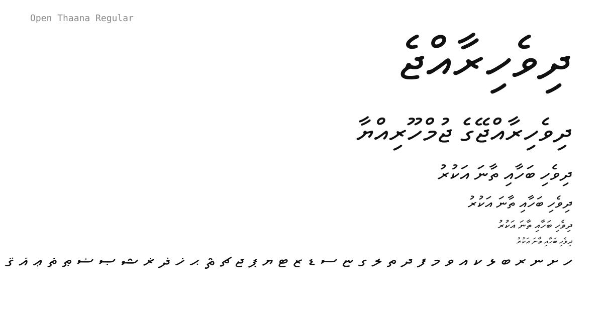

# Open Thaana

A Thaana typeface by Mohamed Shiyam, created with Dhivehi Font Studio (seed 2757242952).

**A free and open font.** Anyone may use, study, modify and redistribute it, including commercially.



## Supported scripts

- Thaana consonants (U+0780-U+0797)
- Arabic-derived Thaana letters (U+0798-U+07A5)
- Fili vowel marks and sukun (U+07A6-U+07B0)
- Thaana letter naa (U+07B1)
- Space (U+0020, U+00A0)

Thaana is written right to left. The fili are combining marks with zero
advance width, and this font carries a GPOS `mark` feature so they centre
over their consonant automatically. It does **not** include Latin letters
or digits -- pair it with a Latin font for mixed text.

## Installing

### Desktop

- **Windows** - select `fonts/ttf/OpenThaana-Regular.ttf`, right-click, Install.
- **macOS** - double-click `fonts/otf/OpenThaana-Regular.otf` and press Install Font.
- **Linux** - copy the file into `~/.local/share/fonts/` and run `fc-cache -f -v`.

### Web

```css
@font-face {
  font-family: "Open Thaana";
  src: url('fonts/woff2/OpenThaana-Regular.woff2') format('woff2'),
       url('fonts/woff/OpenThaana-Regular.woff') format('woff');
  font-weight: 400;
  font-style: normal;
  font-display: swap;
}

.thaana {
  font-family: "Open Thaana", sans-serif;
  direction: rtl;
  unicode-bidi: isolate;
}
```

```html
<p class="thaana" lang="dv">ދިވެހިރާއްޖެ</p>
```

## Repository layout

```
fonts/ttf/        installable TrueType
fonts/otf/        installable OpenType/CFF
fonts/woff/       web font, universal browser support
fonts/woff2/      web font, best compression
sources/          UFO 3 source, editable in Glyphs, RoboFont, FontForge
documentation/    specimen and glyph sheets
build.py          rebuild every binary from the source
```

## Building from source

The source of truth is the UFO in `sources/`. To rebuild the binaries:

```bash
pip install -r requirements.txt
python build.py
```

This compiles the UFO with `fontmake` and writes TTF, OTF, WOFF and WOFF2
into `fonts/`. `make` does the same if you prefer.

## Font information

| | |
|---|---|
| Family | Open Thaana |
| Style | Regular |
| Version | 1.000 |
| Units per em | 1000 |
| Glyphs | 50 |
| Weight class | 400 |
| Licence | SIL Open Font License 1.1 |

## Licence

Open Thaana is licensed under the **SIL Open Font License 1.1**.

Anyone may use, study, modify and redistribute it, including commercially.

In short:

- The font may not be sold on its own (it may be bundled and sold with anything else).
- The full licence text must travel with the font.
- Modified versions must also be released under the OFL.

The full text is in [`OFL.txt`](OFL.txt).

Copyright 2026 Mohamed Shiyam. See `AUTHORS.txt` and `FONTLOG.txt`.

## Contributing

Bug reports, glyph corrections and spacing fixes are welcome. See
[CONTRIBUTING.md](CONTRIBUTING.md).

---

Built with Dhivehi Font Studio.
